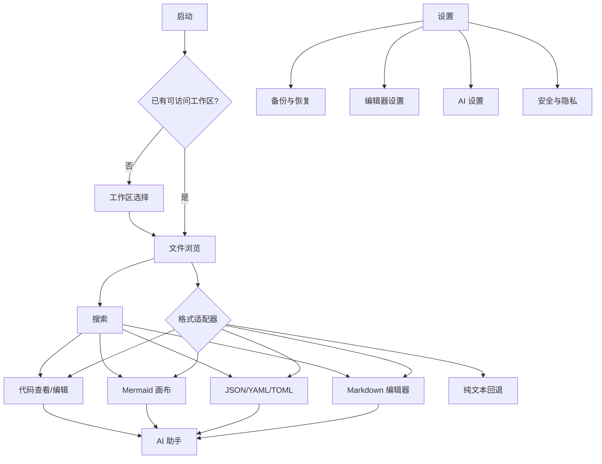
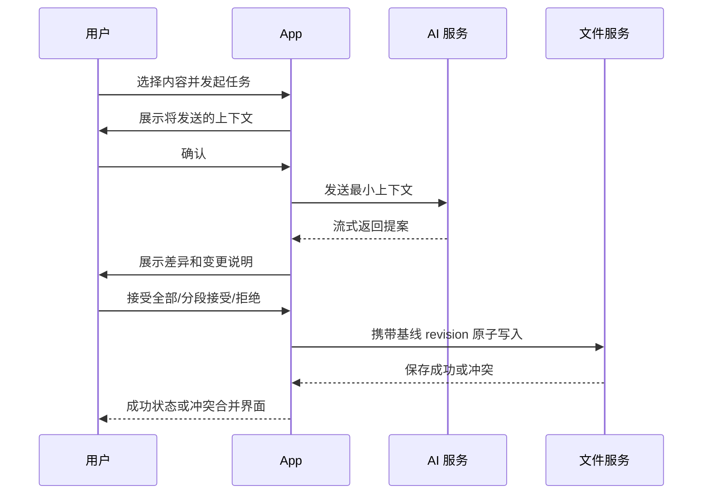
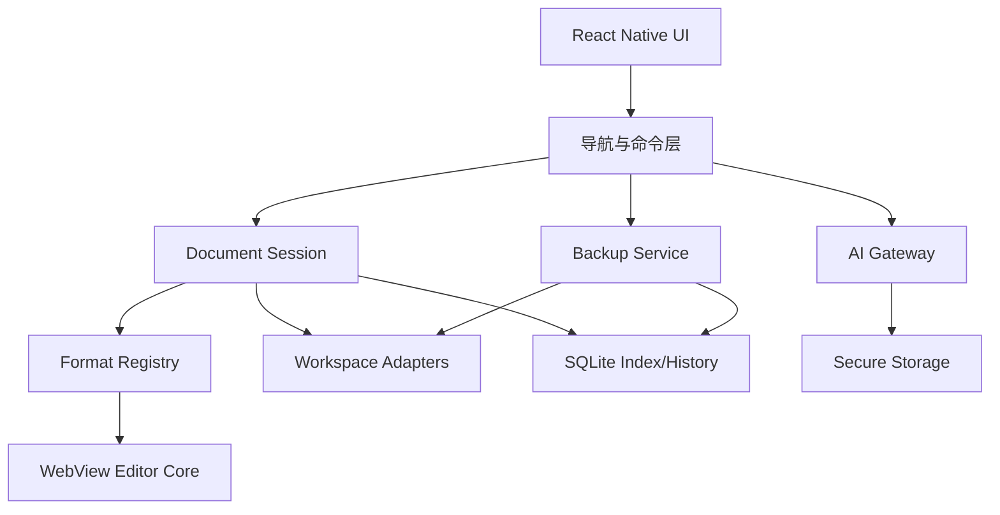

# VMark Mobile 高保真实现文档

> 文档状态：可评审草案  
> 版本：v1.0  
> 日期：2026-07-30  
> 目标平台：iOS、Android，手机优先，兼容平板与横屏  
> 产品代号：VMark Mobile（正式发布前必须更换为自有品牌名）

## 0. 一页结论

本项目要做的不是把桌面端 VMark 缩小到手机，而是做一款“本地优先、多格式、AI 辅助”的移动纯文本工作区。它应高保真复现参考图里的工作流、信息密度和视觉语言，并针对单手与双拇指操作重新组织控件。

首版必须完整覆盖：

1. 工作区选择与授权；
2. 按格式浏览、筛选和管理文件；
3. Markdown 所见即所得、源码与快速切换；
4. JSON、YAML、TOML 的源码、树形和表格视图；
5. Mermaid 源码编辑、渲染、缩放与导出；
6. 常用代码文件的高亮查看和显式编辑；
7. 文件名、内容和历史记录搜索；
8. 本地历史、手动备份、自动备份和恢复；
9. 主题、字体、编辑器、AI、存储与隐私设置；
10. 显式上下文、先预览后应用的 AI 辅助。

明确不做：

- 终端、Shell、命令执行；
- 代码运行、调试、LSP、包管理器；
- Git 客户端界面；
- 桌面端插件直接加载；
- 默认云端账号体系和多人协作；
- 在预览中执行 HTML、SVG 或 Mermaid 中的任意脚本；
- 展示模型的私有思维链。AI 页面只显示“处理进度、依据摘要和变更说明”。

推荐实现为 React Native 原生应用壳 + 离线 WebView 编辑内核。原生层负责导航、文件授权、列表、搜索、备份、安全存储和系统集成；WebView 内核承载 CodeMirror 6、Markdown 富文本和 Mermaid。文件内容是唯一真源，SQLite 仅保存可重建索引和应用状态。

## 1. 需求来源与范围解释

### 1.1 参考图

参考图见"C:\Users\gan79\Desktop\图"

参考图标题写“8 大核心界面”，但可辨认的独立功能面实际有 9 个：工作区、文件、Markdown、结构化数据、Mermaid、代码、搜索、备份、设置；另有一个 AI 助手入口。本文全部保留，不因编号冲突删减功能。

### 1.2 “高保真/拇指级模仿”的定义

本项目将其解释为同时满足两类目标：

- 高保真：页面层级、控件位置、卡片风格、蓝色强调色、文件类型色彩、编辑器工具栏、模式切换方式与参考图一致；
- 拇指友好：高频操作位于底部或键盘上方，点击热区足够大，关键流程不依赖精确小图标或多指手势。

参考图是压缩后的概念图，不足以直接作为逐像素标注。因此开工前需要先建立 Figma 基准稿；本文给出设计令牌、组件和验收容差，设计师据此补齐普通、按下、禁用、加载、错误、空状态和深色模式。

### 1.3 产品定位

一句话定位：

> 随时打开一个本地文件夹，用最适合内容的视图阅读、编辑、理解和整理纯文本文件。

核心价值：

- 多格式感知：不是所有文件都塞进同一个文本框；
- 本地优先：文档默认不上传，不要求登录；
- 快速切换：同一文件可在源码、渲染、树形、表格和差异视图间切换；
- AI 可控：只读取用户显式选择的内容，只以提案形式修改文件；
- 可扩展：格式能力通过注册表增加，不把页面逻辑写死在文件扩展名判断中。

## 2. 信息架构与导航

### 2.1 一级导航

底部固定四个主入口：

| Tab | 默认页面     | 主要任务               |
| --- | -------- | ------------------ |
| 文件  | 最近使用的工作区 | 选择工作区、浏览和编辑文件      |
| 搜索  | 全局搜索     | 搜索文件名、内容、历史和最近活动   |
| AI  | AI 助手面板  | 解释、重写、续写、总结、翻译、重构  |
| 设置  | 设置首页     | 编辑器、AI、存储、备份、安全和隐私 |

底部栏在文件编辑时可自动收起，把空间让给内容；从屏幕底边轻扫或点击标题栏可恢复。键盘出现后，格式工具栏固定在键盘上方，主 Tab 栏隐藏。

### 2.2 页面层级



### 2.3 通用导航规则

- 文件默认直接以“上次使用视图”打开；首次打开则使用格式默认视图；
- 标题栏左侧始终返回，中央显示文件名和格式胶囊，右侧放搜索、AI、更多；
- “更多”承载低频动作：重命名、移动、复制路径、分享、导出、历史、删除；
- 长按文件行打开上下文菜单；左滑只暴露“固定”和“更多”，删除必须二次确认；
- 编辑状态下的返回不会丢内容：已保存直接返回，保存中等待，失败时显示“重试/保留草稿/放弃”；
- Android 系统返回键与 iOS 边缘返回手势使用同一状态机。

## 3. 视觉与交互规范

### 3.1 视觉方向

视觉方向为“温润纸张上的精密工具”：

- 暖白背景，避免纯白刺眼；
- 深墨色正文，钴蓝色作为唯一品牌强调色；
- 文件类型使用克制的语义色；
- 卡片阴影非常轻，主要靠边框和层级区分；
- 编辑区尽量无装饰，把视觉重心留给内容；
- 深色模式不是简单反色，而是使用深蓝灰纸面和降低饱和度的格式色。

### 3.2 设计令牌

| 类别               | Light     | Dark      | 用途      |
| ---------------- | --------- | --------- | ------- |
| `bg.canvas`      | `#F7F7F4` | `#11141A` | 页面底色    |
| `bg.surface`     | `#FFFFFF` | `#191D25` | 卡片、浮层   |
| `bg.subtle`      | `#F0F2F7` | `#222834` | 选中、次级区  |
| `text.primary`   | `#171A22` | `#F2F4F8` | 正文      |
| `text.secondary` | `#6C7280` | `#A6ADBA` | 说明文字    |
| `border.default` | `#E3E6EC` | `#303744` | 边框      |
| `accent.primary` | `#1747D1` | `#6F91FF` | 主操作、选中  |
| `accent.pressed` | `#1037A9` | `#8AA5FF` | 按下态     |
| `success`        | `#15875B` | `#4CC38A` | 保存、同步成功 |
| `warning`        | `#C77800` | `#F1B24B` | 解析警告    |
| `danger`         | `#C93838` | `#FF7373` | 删除、错误   |
| Markdown         | `#2C64D8` | `#78A0FF` | 文件类型    |
| YAML             | `#EE8B23` | `#F5AC5E` | 文件类型    |
| JSON             | `#2E9B67` | `#61C993` | 文件类型    |
| TOML             | `#8C62D8` | `#B995F1` | 文件类型    |
| Mermaid          | `#D05B9B` | `#EA8EC0` | 文件类型    |
| Code             | `#4E6677` | `#91A7B7` | 文件类型    |

间距使用 4pt 基线：`4 / 8 / 12 / 16 / 20 / 24 / 32`。页面左右安全边距为 16pt；卡片内边距 16pt；列表行高 52-60pt；卡片圆角 12pt；底部浮动工具栏圆角 18pt。

### 3.3 字体

- iOS 中文：PingFang SC；拉丁字符：SF Pro；
- Android 中文：Noto Sans CJK SC；拉丁字符：Roboto；
- 代码：优先 JetBrains Mono，失败时回退系统等宽字体；
- 导航标题 17pt/600，正文 15-17pt，说明 12-13pt；
- 编辑器默认字号 16pt，行高 1.65，用户可调整为 13-24pt；
- 支持系统动态字体，但代码编辑器最大缩放单独控制，避免断行失控。

### 3.4 拇指操作

- iOS 高频控件热区不小于 44×44pt；Android 不小于 48×48dp；
- 可见图标可以是 20-24pt，但透明热区必须扩到最小尺寸；
- 高频动作放在屏幕下半区：保存状态、撤销/重做、视图切换、插入和 AI；
- 顶部只保留返回、文件身份和低频入口；
- 长按不是唯一入口，所有长按能力都要在“更多”菜单中可发现；
- 滑动、捏合等手势必须有按钮替代方案；
- 按下态同时提供颜色、缩放或轻触觉反馈；
- 横屏时左右拇指分工：左侧视图/文件，右侧编辑/画布动作。

### 3.5 动效

- 页面推进 220ms，底部 Sheet 260ms，视图切换 160ms；
- 保存成功只显示 1 秒轻量状态，不弹阻塞 Toast；
- 解析视图采用 150-250ms 防抖，输入期间保留上一次有效预览；
- 支持系统“减少动态效果”，届时去掉缩放和弹性动画；
- 不使用持续渐变、粒子或无意义循环动画。

## 4. 页面级功能规格

### 4.1 工作区选择

目标：让用户理解“工作区是一个本地文件夹”，并清楚授予了哪些访问权限。

页面组成：

- 标题“选择工作区”；
- 工作区卡片：图标、名称、路径摘要、上次打开时间、访问状态；
- 选中项用淡蓝底和蓝色勾选；
- “添加工作区”卡片；
- 底部文字按钮“导入工作区备份”；
- 首次使用显示本地优先说明，不展示账户注册。

行为：

- iOS 使用系统文档选择器选择目录并保存 security-scoped bookmark；
- Android 使用 Storage Access Framework 选择目录并持久化 URI 权限；
- 权限失效时卡片显示“需要重新授权”，不静默创建同名空工作区；
- 工作区可固定、重命名显示名、重新授权和移除；
- “移除”只移除应用记录，绝不删除原文件夹；
- 最近一次成功打开的工作区作为下次启动默认项。

验收：

- 首次授权不超过 3 步；
- 权限被系统撤回后能明确恢复；
- 同一路径不会创建重复工作区记录；
- 用户可以随时看见真实存储位置。

### 4.2 文件浏览

页面组成：

- 顶部工作区切换器、搜索、排序和更多；
- “全部文件”入口；
- 按格式聚合：Markdown、YAML、JSON、TOML、Mermaid、SVG、HTML、代码、其他；
- 行尾显示文件数量；
- 底部 Tab 栏；
- 右下角可选新建按钮，点击后弹出“文件/文件夹/从模板”。

列表和文件夹视图可切换。首版默认采用参考图里的格式聚合视图，同时在“全部文件”中保留真实目录树，防止分类视图隐藏文件位置。

文件操作：

- 新建、重命名、移动、复制、分享、删除；
- 最近使用、收藏、按名称/时间/类型/大小排序；
- 文件名冲突时提供“替换、保留两者、取消”；
- 删除优先进入应用内回收站；外部 Provider 不支持回收时必须二次确认；
- 未识别的文本格式使用纯文本适配器，二进制文件调用系统分享/打开。

### 4.3 Markdown 编辑器

默认模式为所见即所得，保留源码模式和快速源码查看。

顶部：

- 返回；
- Markdown 图标、文件名、脏状态点；
- AI、搜索、更多。

内容区：

- 所见即所得模式；
- 源码模式；
- 横屏可选“编辑/预览”双栏；
- 状态栏显示行列、编码、格式、保存状态。

键盘工具栏：

- 撤销、重做；
- 粗体、斜体、删除线、行内代码；
- 标题、列表、任务、引用、代码块；
- 链接、图片、表格；
- 收起键盘和更多格式。

编辑能力：

- 标题、段落、引用、有序/无序/任务列表；
- 代码块与语法高亮；
- 表格编辑；
- 链接、Wiki 链接、图片和本地附件；
- Markdown frontmatter；
- 基础数学公式与 Mermaid 围栏预览；
- 中文、英文间距格式化；
- 查找、替换、撤销、重做；
- 自动保存和历史快照；
- 块级源码查看：长按块或从更多菜单进入，不强依赖桌面快捷键。

手机端不在 v1 追求桌面级富文本多光标。源码模式可保留多选区基础能力，但 UI 不把多光标作为首要卖点。

### 4.4 JSON、YAML、TOML 结构化预览

同一文件提供以下视图：

- 树视图：可折叠节点、类型、路径复制；
- 原文：CodeMirror 源码编辑；
- 表格视图：仅当根节点或选中节点为对象数组时启用；
- 差异视图：当前内容与最后一次保存/历史版本比较。

行为：

- 默认打开上次使用视图；
- 源码输入后 200ms 防抖解析；
- 解析失败时保留上一次有效结构预览，并在源码行号槽和底部错误条中同时标记；
- 树节点长按提供复制键、复制值、复制 JSONPath/YAML Path；
- 表格支持横向滚动、列冻结和列宽重置；
- 不自动重排用户源码；格式化必须是显式命令，并先显示差异；
- YAML 禁止不安全类型构造，只解析数据；
- JSONL 采用逐行虚拟化，不将整个文件解析为巨大数组。

架构感知视图作为第二阶段适配器：

- `package.json`：依赖分组；
- `Cargo.toml`：依赖树；
- `pyproject.toml`：Python 项目依赖；
- `.github/workflows/*.yml`：工作流 DAG。

### 4.5 Mermaid 图表

页面结构：

- 顶部文件名与预览状态；
- 主画布；
- 底部工具栏：编辑源码、适应屏幕、居中、缩小、放大、导出；
- 源码以底部 Sheet 或横屏左栏出现；
- 画布支持单指平移、双指缩放。

规则：

- Mermaid 库随 App 离线打包，不从 CDN 加载；
- 默认 `securityLevel: "strict"`，禁用点击回调、脚本和任意导航；
- 解析与渲染放在隔离 WebView 中；
- 250ms 防抖，渲染超时 2 秒后中止并给出错误；
- 限制最大文本、节点和边数量，防止恶意或意外大图卡死；
- 支持导出 PNG、SVG 和分享；
- 导出的 SVG 再净化一次；
- 旋转横屏后保持缩放中心和当前选中节点。

### 4.6 代码查看与编辑

首版支持：

`.ts`、`.tsx`、`.js`、`.jsx`、`.py`、`.rs`、`.go`、`.css`、`.sh`、`.bash`、`.rb`、`.lua`。

默认只读，顶部显示“查看模式”。用户点击“启用编辑”后，本次会话可编辑；设置中可改为记住每种扩展名的选择。

能力：

- 语法高亮、行号、折行、查找；
- 复制行、跳转到行；
- 显式开启编辑、保存和差异查看；
- 大文件虚拟化；
- 分享到外部编辑器或其他 App。

明确不提供：

- 运行按钮；
- Shell；
- LSP 自动补全；
- 调试；
- 安装依赖；
- 任意命令执行。

即使文件扩展名为脚本，也一律作为纯文本读取和保存。

### 4.7 搜索

搜索入口同时支持：

- 全部；
- 文件名；
- 内容；
- 历史。

结果按“文件、内容匹配、历史记录、最近活动”分组，突出关键词和上下文。点击内容匹配后打开正确格式视图，并定位到行、块或树路径。

索引规则：

- 文件系统是真源，SQLite FTS 索引可随时重建；
- 小文件在授权/修改后增量索引；
- 大文件按流式分块索引；
- 代码文件默认只索引文件名，用户可在设置中开启内容索引；
- 密钥、`.env`、证书、隐藏目录和用户排除规则默认不索引；
- 搜索历史默认只在本机保存，可一键清除；
- 索引任务不得阻塞编辑与保存。

### 4.8 本地同步、历史与备份

参考图中的“同步”需要拆成三个清晰概念，避免误导用户：

1. 保存：把当前编辑写回原文件；
2. 历史：保存文档的本地版本快照；
3. 备份：把工作区打成可恢复归档，写到用户选择的位置。

MVP 不宣传“多设备实时云同步”。如果工作区本身位于 iCloud Drive、Google Drive 或其他系统文件 Provider，App 只显示 Provider 状态，不声称自己实现了同步。

页面卡片：

- 本地存储占用；
- 最近保存与索引状态；
- 自动备份开关、时间、保留天数；
- 手动备份按钮、上次备份时间和大小；
- 备份管理；
- 备份位置；
- 恢复演练入口。

历史策略默认值：

- 自动保存防抖：2 秒；
- 连续保存合并窗口：30 秒；
- 每文档最多 50 个快照；
- 默认保留 30 天；
- 超过 1MB 的单文件默认不创建全文快照，只记录元数据和手动检查点；
- 内容相同不重复创建快照。

备份格式：

```text
workspace-backup-2026-07-30T233000.vmbak
├── manifest.json
├── files/
├── metadata/
│   ├── history.sqlite
│   └── settings.json
└── checksums.json
```

恢复必须先扫描归档、验证校验和、显示文件数量和冲突策略，再写入目标目录。禁止 Zip Slip 路径穿越。可选密码备份使用平台密码学能力实现 AES-256-GCM；密钥不得写入归档。

### 4.9 设置

设置分组与参考图保持一致：

编辑器：

- 主题：跟随系统、浅色、深色；
- 正文字体、代码字体；
- 字号、行高；
- 行号、自动换行、空白字符；
- 自动配对；
- 自动保存和间隔；
- 大文件策略。

AI：

- 默认服务商和模型；
- 默认策略：解释、重写、总结等；
- “显示处理摘要”开关；
- 是否允许发送文件名；
- 最大上下文；
- 每次应用修改前预览；
- 密钥管理和连接测试。

本地：

- 默认保存位置；
- 资产目录命名；
- 索引排除规则；
- 历史与备份；
- 存储占用与清理。

安全与隐私：

- App 锁；
- 生物识别；
- 剪贴板读取策略；
- 网络访问记录；
- 清除搜索/AI/历史元数据；
- 应用权限状态；
- 隐私说明和开源许可证。

### 4.10 AI 助手

AI 助手既可作为底部 Tab 打开，也可从选区、文件或结构节点进入。

预设动作：

- 解释选中内容；
- 继续写作；
- 改写与润色；
- 总结；
- 翻译；
- 生成标题/大纲；
- 重构 JSON/YAML/TOML；
- 解释代码；
- 生成或修复 Mermaid。

上下文规则：

- 默认只发送用户当前选区；
- 用户可显式添加当前块、当前文件或勾选的多个文件；
- 发送前显示“将发送什么”；
- 敏感文件命中规则时阻止发送并解释原因；
- AI 不得隐式遍历整个工作区；
- API Key 存入 iOS Keychain/Android Keystore；
- 日志不保存完整提示词和文档内容。

修改流程：



AI 页面不得声称展示模型完整“思考过程”。可以展示：

- 正在读取选中内容；
- 正在生成提案；
- 使用了哪些显式上下文；
- 变更了哪些段落或键；
- 风险、假设和未处理项摘要。

## 5. 格式能力注册表

禁止在页面里散落 `if extension === ...`。所有格式通过注册表声明能力。

```ts
type ViewKind =
  | "wysiwyg"
  | "source"
  | "preview"
  | "tree"
  | "table"
  | "diff";

interface FormatAdapter {
  id: string;
  extensions: string[];
  mimeTypes: string[];
  defaultView: ViewKind;
  supportedViews: ViewKind[];
  editable: boolean | "opt-in";
  searchable: boolean;
  parser?: "markdown" | "json" | "yaml" | "toml" | "mermaid";
  largeFilePolicy: "normal" | "source-only" | "stream";
  securityProfile: "text" | "structured-data" | "sandboxed-render";
}
```

首版注册表：

| 适配器          | 默认视图  | 可用视图           | 编辑   |
| ------------ | ----- | -------------- | ---- |
| Markdown     | 所见即所得 | 所见即所得、源码、预览、差异 | 是    |
| Text         | 源码    | 源码、差异          | 是    |
| YAML         | 树     | 树、源码、表格、差异     | 是    |
| JSON/JSONL   | 树     | 树、源码、表格、差异     | 是    |
| TOML         | 树     | 树、源码、表格、差异     | 是    |
| Mermaid      | 预览    | 预览、源码、差异       | 是    |
| Code         | 源码    | 源码、差异          | 显式开启 |
| Unknown text | 源码    | 源码             | 显式开启 |
| Binary       | 系统预览  | 系统能力           | 否    |

## 6. 技术架构

### 6.1 推荐技术栈

| 层            | 推荐                                                    |
| ------------ | ----------------------------------------------------- |
| App 壳        | React Native + TypeScript，新架构                         |
| 工程工具         | Expo Prebuild/Development Build，不依赖 Expo Go 作为生产约束    |
| 路由           | React Navigation                                      |
| 原生状态         | Zustand 或轻量 reducer，服务状态与 UI 状态分离                     |
| 数据请求/后台任务状态  | TanStack Query，仅用于异步任务，不把文件内容当远程缓存                    |
| 元数据          | SQLite，启用 FTS                                         |
| 文件           | 自建 `WorkspaceAdapter`，封装 iOS bookmark 与 Android SAF   |
| 编辑内核         | 本地 WebView bundle                                     |
| 源码编辑         | CodeMirror 6                                          |
| Markdown 富文本 | Tiptap/ProseMirror                                    |
| 结构化解析        | `JSON.parse`、`yaml` 安全模式、`smol-toml` 或等价库             |
| Mermaid      | Mermaid，离线打包、严格安全配置                                   |
| 密钥           | SecureStore/Keychain/Keystore                         |
| 崩溃与日志        | 默认本地；上传必须单独征得用户同意                                     |
| 测试           | Vitest/Jest、React Native Testing Library、Maestro、截图基线 |

不要锁死本文中的具体依赖版本。开工时以同一 React Native/Expo 稳定兼容矩阵锁定版本，并提交 lockfile；升级必须经过编辑器、文件写入和 WebView 通信回归。

### 6.2 分层



职责：

- UI：只表达页面状态和用户意图；
- 导航与命令层：统一打开、保存、切换视图、搜索、AI、备份命令；
- Document Session：维护内容、revision、脏状态、保存和冲突；
- Format Registry：选择适配器与能力；
- WebView Editor Core：编辑、解析、渲染，不直接拥有系统文件权限；
- Workspace Adapter：所有文件读写和授权；
- SQLite：派生索引、历史、最近记录和设置；
- AI Gateway：提供商适配、最小上下文、流式结果和提案；
- Backup Service：校验、归档、恢复和保留策略。

### 6.3 原生与 WebView 通信

通信使用版本化 JSON-RPC，不直接拼接 JavaScript 字符串。

关键消息：

```ts
type EditorMessage =
  | { type: "editor.ready"; protocol: 1 }
  | { type: "document.open"; sessionId: string; revision: string; content: string }
  | { type: "document.change"; sessionId: string; baseRevision: string; changes: Change[] }
  | { type: "document.saveRequested"; sessionId: string }
  | { type: "document.saved"; sessionId: string; revision: string }
  | { type: "view.change"; view: ViewKind }
  | { type: "selection.change"; ranges: TextRange[] }
  | { type: "diagnostics.update"; items: Diagnostic[] }
  | { type: "render.exportRequested"; format: "png" | "svg" };
```

要求：

- 每条消息校验 schema、`sessionId` 和协议版本；
- 大文件初次载入走分块或本地资源协议，避免 Base64；
- 变更尽量发送增量 transaction，不在每次按键传完整文档；
- WebView 禁止任意网络导航、`window.open` 和文件系统直连；
- App 切后台前，原生层要求编辑器 flush 未发送变更；
- WebView 崩溃后从 Document Session 恢复，不把 WebView 内存视为唯一草稿。

### 6.4 文件和工作区适配器

```ts
interface WorkspaceAdapter {
  authorize(): Promise<WorkspaceGrant>;
  restoreGrant(serializedGrant: string): Promise<WorkspaceGrant>;
  list(path: string): Promise<FileEntry[]>;
  stat(path: string): Promise<FileStat>;
  readText(path: string, options?: ReadOptions): Promise<TextReadResult>;
  writeTextAtomic(path: string, content: string, expectedRevision: string): Promise<WriteResult>;
  move(from: string, to: string): Promise<void>;
  remove(path: string, mode: "trash" | "permanent"): Promise<void>;
  watch?(path: string, listener: FileChangeListener): Unsubscribe;
}
```

实现两类工作区：

- Managed Workspace：位于 App 可控目录，原子写、备份和恢复能力最完整；
- Linked Workspace：用户从系统文件选择器授权的外部目录，尊重 Provider 能力差异。

外部 Provider 不保证 rename、atomic replace、watch 或后台写入。适配器必须返回 capability，界面只显示实际支持的动作。

### 6.5 保存与冲突

revision 由 Provider 稳定标识、修改时间、大小和内容摘要组合生成。

保存流程：

1. 打开时记录基线 revision；
2. 编辑变更进入内存草稿和恢复日志；
3. 自动保存前重新读取目标 revision；
4. 未变化则执行临时文件写入 + replace；Provider 不支持时使用能力受限路径；
5. 外部已变化则停止覆盖，生成三方差异；
6. 用户选择保留本地、保留外部或手动合并；
7. 成功后更新 revision、历史和搜索索引。

任何失败都不能把编辑器误标为“已保存”。

## 7. 数据模型

文件系统内容是真源，以下表均为派生或应用状态。

```sql
CREATE TABLE workspaces (
  id TEXT PRIMARY KEY,
  display_name TEXT NOT NULL,
  adapter_type TEXT NOT NULL,
  serialized_grant TEXT NOT NULL,
  capabilities_json TEXT NOT NULL,
  last_opened_at INTEGER,
  created_at INTEGER NOT NULL
);

CREATE TABLE file_index (
  workspace_id TEXT NOT NULL,
  file_id TEXT NOT NULL,
  relative_path TEXT NOT NULL,
  format_id TEXT NOT NULL,
  size INTEGER NOT NULL,
  modified_at INTEGER,
  revision TEXT NOT NULL,
  indexed_at INTEGER,
  PRIMARY KEY (workspace_id, file_id)
);

CREATE VIRTUAL TABLE file_search USING fts5(
  workspace_id UNINDEXED,
  file_id UNINDEXED,
  relative_path,
  content,
  tokenize = 'unicode61'
);

CREATE TABLE document_history (
  id TEXT PRIMARY KEY,
  workspace_id TEXT NOT NULL,
  file_id TEXT NOT NULL,
  base_revision TEXT NOT NULL,
  snapshot_type TEXT NOT NULL,
  content_blob BLOB,
  created_at INTEGER NOT NULL,
  reason TEXT NOT NULL
);

CREATE TABLE editor_sessions (
  session_id TEXT PRIMARY KEY,
  workspace_id TEXT NOT NULL,
  file_id TEXT NOT NULL,
  view_kind TEXT NOT NULL,
  selection_json TEXT,
  scroll_json TEXT,
  dirty INTEGER NOT NULL,
  recovery_blob BLOB,
  updated_at INTEGER NOT NULL
);

CREATE TABLE backups (
  id TEXT PRIMARY KEY,
  workspace_id TEXT NOT NULL,
  destination_uri TEXT NOT NULL,
  checksum TEXT,
  size INTEGER,
  status TEXT NOT NULL,
  created_at INTEGER NOT NULL
);
```

不在数据库中长期保存：

- API Key 明文；
- 完整 AI 提示词和响应；
- 可从文件系统重建的重复全文副本，历史策略明确要求的快照除外；
- 外部 Provider 的临时授权令牌明文日志。

## 8. 性能预算

参考目标以中端真机为准，不以模拟器成绩代替。

| 场景                   | P50     | P95     |
| -------------------- | ------- | ------- |
| 冷启动到可操作              | ≤ 1.5s  | ≤ 2.5s  |
| 恢复最近工作区              | ≤ 500ms | ≤ 1s    |
| 1000 项文件列表首屏         | ≤ 300ms | ≤ 600ms |
| 500KB Markdown 源码打开  | ≤ 500ms | ≤ 1s    |
| 500KB Markdown 富文本打开 | ≤ 1s    | ≤ 2s    |
| 单次按键到可见更新            | ≤ 50ms  | ≤ 100ms |
| 结构化预览更新              | ≤ 250ms | ≤ 500ms |
| Mermaid 普通图渲染        | ≤ 500ms | ≤ 1s    |
| 搜索首批结果               | ≤ 300ms | ≤ 700ms |
| 自动保存完成               | ≤ 500ms | ≤ 1.5s  |

大文件策略：

| 大小       | 行为                           |
| -------- | ---------------------------- |
| `< 1MB`  | 正常打开全部适用视图                   |
| `1-5MB`  | 默认源码模式；用户可尝试富文本              |
| `5-20MB` | 确认后仅源码/流式视图                  |
| `≥ 20MB` | 移动端默认拒绝全文编辑，可只读分块查看或交给外部 App |

阈值要通过真机压测调整。移动端内存预算比桌面更严格，不直接照搬桌面端 50MB 上限。

## 9. 安全与隐私

### 9.1 默认策略

- 无账户也能完整使用本地功能；
- 除 AI 请求和用户主动分享外，不发送文档、文件名和路径；
- 不接入广告或行为分析 SDK；
- 崩溃上传必须单独征得同意，并在上传前去除路径和正文；
- 网络访问由单一网关发出，可在设置中查看最近访问的域名和原因。

### 9.2 文件安全

- 所有路径都先规范化并验证位于已授权工作区；
- 禁止 `..`、符号链接越界和归档路径穿越；
- 删除、移动、覆盖使用明确目标和冲突确认；
- 临时文件使用随机名和受限目录；
- 备份恢复先校验 manifest、版本和 checksum；
- 不对脚本文件添加可执行权限。

### 9.3 渲染安全

- Mermaid 严格模式；
- SVG 使用白名单净化，禁用 script、event handler、外链和 foreignObject；
- HTML 预览不进入 v1；未来启用时必须使用无权限 sandbox、DOM 净化和 CSP 三层隔离；
- WebView 只加载随 App 签名打包的资源；
- 外部链接交给系统浏览器，并在离开 App 前提示真实域名。

### 9.4 AI 安全

- 默认最小上下文；
- Keychain/Keystore 保存密钥；
- 远程端点必须 HTTPS，本机调试端点仅开发构建允许；
- 模型输出永远按不可信文本处理；
- AI 不能直接写文件，必须经过提案、revision 检查和用户确认；
- 提案中的链接、HTML、SVG、Mermaid 仍走各自安全管线；
- 隐藏思维链不记录、不请求、不展示。

## 10. 离线与错误状态

所有核心编辑能力离线可用。必须设计以下状态，而不是只做成功页面：

- 工作区未授权/授权过期；
- 文件被外部删除、移动或修改；
- 保存失败、磁盘满、Provider 只读；
- WebView 崩溃；
- 解析错误；
- Mermaid 超时；
- 搜索索引损坏和重建；
- 备份中断、校验失败；
- AI 断网、限流、密钥错误、用户取消；
- App 被系统杀死后的未保存草稿恢复。

错误文案必须回答三件事：发生了什么、数据是否安全、用户下一步能做什么。

## 11. 无障碍与国际化

- VoiceOver/TalkBack 可完整浏览导航、文件列表、工具栏和设置；
- 图标必须有可读标签，不能只读“按钮”；
- 文件类型不能仅靠颜色区分，同时显示图标或文字；
- 支持动态字体、粗体文本、高对比度、减少动态效果；
- 焦点顺序与视觉顺序一致；
- 编辑器工具栏在屏幕阅读器模式下提供分组名称；
- 所有重要状态同时使用文字、颜色和图标；
- 首版提供简体中文和英文；
- 文案使用 key 管理，不在组件内硬编码；
- 日期、时间、存储大小和排序遵循系统区域设置。

## 12. 测试与验收

### 12.1 自动化分层

单元测试：

- 格式注册、路径规范化、revision、差异、历史保留；
- JSON/YAML/TOML 安全解析；
- Markdown round-trip；
- Mermaid 限额和超时；
- 备份 manifest 与 checksum；
- AI 上下文过滤和敏感文件规则。

契约测试：

- Native ↔ WebView 协议；
- iOS/Android WorkspaceAdapter 能力；
- 保存成功、冲突、失败状态机；
- 格式适配器统一行为。

集成测试：

- 授权目录 → 浏览 → 打开 → 编辑 → 保存 → 重启恢复；
- 外部修改冲突；
- 搜索增量索引；
- 历史恢复；
- 备份与恢复；
- AI 提案部分接受。

端到端测试：

- iOS 真机/模拟器；
- Android 真机/模拟器；
- 小屏、标准屏、横屏、平板；
- 浅色、深色、动态字体；
- 中文、英文输入法；
- 无网、弱网、切后台、低存储。

### 12.2 高保真视觉验收

先以 390×844pt iPhone 参考画板建立基线，再增加 Android 标准画板。

关键页面要求：

- 主要锚点偏差不超过 2pt；
- 颜色与设计令牌一致，截图对比允许抗锯齿容差；
- 字体基线偏差不超过 1 行高的 5%；
- 卡片圆角、边框、间距、选中态与 Figma 一致；
- 所有按钮具备普通、按下、禁用、加载、错误状态；
- 深色模式单独出图，不允许自动反色；
- 旋转、键盘弹出和动态字体不遮挡主要操作。

不使用全屏像素差作为唯一标准，因为 iOS/Android 字体栅格化不同；采用锚点、令牌、组件截图和人工走查组合验收。

### 12.3 发布阻断条件

以下任一项失败不得发布：

- 保存失败却显示成功；
- 发生可复现的数据丢失或静默覆盖；
- 工作区路径越权；
- 恶意 Mermaid/SVG 导致脚本执行或外部导航；
- API Key 出现在日志、备份或普通数据库；
- App 被杀后无法恢复已确认存在的未保存草稿；
- 备份无法通过校验或恢复演练；
- 核心流程依赖终端或桌面外部程序。

## 13. 里程碑与资源估算

### 13.1 推荐团队

- 1 名产品/交互设计；
- 2 名 React Native 工程师；
- 1 名编辑器/WebView 工程师；
- 1 名测试工程师；
- 安全和隐私评审按里程碑介入。

### 13.2 排期

| 阶段             | 周期    | 交付                                                         |
| -------------- | ----- | ---------------------------------------------------------- |
| P0 技术 Spike    | 1-2 周 | iOS/Android 文件夹授权写回、CodeMirror 输入法、WebView 增量通信、Mermaid 压测 |
| P1 设计系统与 App 壳 | 2 周   | 导航、主题、令牌、工作区和文件页面                                          |
| P2 文件与文档会话     | 3 周   | WorkspaceAdapter、保存、恢复、冲突和大文件策略                            |
| P3 格式编辑器       | 4 周   | Markdown、JSON/YAML/TOML、Mermaid、代码查看                       |
| P4 搜索、历史和备份    | 3 周   | FTS、版本历史、归档、恢复                                             |
| P5 AI 助手       | 2 周   | Provider、上下文确认、流式提案、差异应用                                   |
| P6 稳定性与发布      | 3 周   | 性能、无障碍、安全、真机和商店准备                                          |

并行后总历时约 14-18 周。单人开发预计 24-32 周，且编辑器兼容与真机文件系统风险会显著增加。

### 13.3 MVP 切割原则

如果必须缩短周期，按以下顺序延后，而不是牺牲保存可靠性：

1. 延后 schema-aware 专用视图；
2. 延后表格列冻结和高级差异；
3. 延后加密备份；
4. 延后 AI 多文件上下文；
5. 延后平板双栏精细适配。

不得删减：

- 工作区权限恢复；
- 原子保存/冲突防护；
- 未保存草稿恢复；
- Mermaid/SVG 安全；
- 备份校验；
- AI 修改前预览；
- 基础无障碍。

## 14. 架构决策记录

### ADR-001：React Native 原生壳 + WebView 编辑内核

状态：建议接受。

决定：

使用 React Native 实现导航和原生功能，使用离线 WebView 承载 CodeMirror、Tiptap/ProseMirror 和 Mermaid。

优点：

- 能复用成熟 Web 编辑生态；
- 原生文件授权、列表、设置和系统分享体验更可靠；
- iOS、Android 共享大部分业务代码。

缺点：

- 需要维护 Native ↔ WebView 协议；
- 输入法、选区和无障碍需专项测试；
- 大文档跨边界传输必须做增量化。

替代方案：

- 全原生：触感最好，但多格式编辑成本和一致性风险最高；
- Flutter：跨端一致，但 CodeMirror/Tiptap 生态仍需 WebView；
- Capacitor 全 Web：开发快，但复杂文件权限、列表性能和原生手感更难保证。

### ADR-002：文件系统为唯一真源

状态：建议接受。

决定：

不把工作区正文导入数据库作为主副本。SQLite 仅保存索引、历史和 UI 状态。

优点：

- 用户可用其他 App 读写同一文件；
- 符合本地优先和开放格式；
- 数据库损坏不等于文档丢失。

缺点：

- 必须处理外部修改和 Provider 差异；
- 文件 rename 后的稳定身份更复杂；
- 索引需要重建机制。

替代方案：

- 数据库真源：事务简单，但导出、互操作和用户信任较差；
- 完整镜像：读写快，但双真源冲突风险高。

### ADR-003：格式注册表

状态：建议接受。

决定：

所有格式声明扩展名、视图、编辑能力、大文件策略和安全配置。

优点：

- 新增格式时不修改所有页面；
- 文件筛选、编辑器、搜索和保存共享同一事实来源；
- 可对格式能力做契约测试。

缺点：

- 初期抽象成本高；
- 注册表变更需要处理已打开会话的重新挂载。

### ADR-004：代码和图表永不执行

状态：必须接受。

决定：

代码只读/编辑，Mermaid/SVG 只渲染，终端与脚本执行不进入产品。

优点：

- 与用户明确排除终端的要求一致；
- 显著缩小攻击面；
- 移动端审核和权限说明更简单。

缺点：

- 无法提供完整 IDE 工作流；
- 某些交互式图表能力受限。

### ADR-005：AI 只生成提案

状态：必须接受。

决定：

AI 不直接写文件；用户查看差异后接受，保存时再验证 revision。

优点：

- 避免静默破坏内容；
- 外部修改冲突可被发现；
- 用户清楚知道发送和改变了什么。

缺点：

- 比“自动执行”多一步；
- 需要实现可靠的差异与部分应用。

## 15. 开工前必须完成的 Spike

在正式排期前，用 1-2 周回答以下问题：

1. iOS security-scoped bookmark 在重启、Provider 离线和权限撤回后的恢复行为；
2. Android SAF 对 rename、replace、watch 和持久 URI 的真实能力矩阵；
3. 中文、日文、英文输入法在 CodeMirror WebView 中的 composition、撤销和光标行为；
4. 1MB、5MB、20MB 文件在目标最低设备上的内存与响应；
5. WebView 增量 transaction 是否能避免全量内容回传；
6. Mermaid 500 节点/1000 边时的渲染、取消和内存；
7. App 被系统杀死后恢复日志能否保证最后一次已输入内容；
8. VoiceOver/TalkBack 是否能操作编辑器和底部工具栏。

Spike 的结果可能调整阈值和底层实现，但不能放宽数据安全与脚本隔离要求。

## 16. Definition of Done

一个功能只有同时满足以下条件才算完成：

- 有正常、空、加载、错误、权限失效和离线状态；
- iOS、Android 真机通过；
- 支持浅色、深色、横屏和动态字体；
- 有单元/契约测试，核心路径有端到端测试；
- 不丢数据，不静默覆盖；
- 无障碍标签与焦点顺序正确；
- 埋点/日志不包含正文、路径或密钥；
- 与 Figma 组件和交互说明一致；
- 文档中用户可见能力与实际行为一致。

## 17. 参考依据

本方案参考了本地 VMark v0.9.18（commit `2805ea81c1fe`）的多格式、Markdown、Mermaid、大文件和本地优先能力边界。VMark 源码使用 ISC License；如果后续直接复制或改编其源码，发布物必须保留原版权与许可证文本。产品名称、Logo、宣传图和品牌识别不因源码许可证自动获得使用权，正式产品应使用自有品牌。

技术依据：

- [React Native New Architecture](https://reactnative.dev/architecture/landing-page)
- [Expo FileSystem](https://docs.expo.dev/versions/latest/sdk/filesystem/)
- [CodeMirror 6 Documentation](https://codemirror.net/docs/)
- [Mermaid securityLevel](https://mermaid.js.org/config/schema-docs/config-properties-securitylevel.html)
- [Apple: Providing access to directories](https://developer.apple.com/documentation/uikit/providing-access-to-directories)
- [Android Storage Access Framework](https://developer.android.com/training/data-storage/shared/documents-files)
- [Apple Accessibility - control size](https://developer.apple.com/design/human-interface-guidelines/accessibility)

## 18. 最终建议

先做 Spike，再做完整 Figma 基准稿，然后进入开发。最需要优先证明的不是 AI 或动画，而是三个底座：

1. 外部工作区能稳定授权和写回；
2. WebView 编辑器在中文输入法和大文件下可靠；
3. 自动保存、冲突和草稿恢复不会丢数据。

这三个底座成立后，参考图中的 9 个功能面都可以在统一设计系统和格式注册表上稳定扩展；如果底座没有证明就直接铺页面，最终会得到“看起来像 VMark、但不敢拿来写文件”的演示品。
